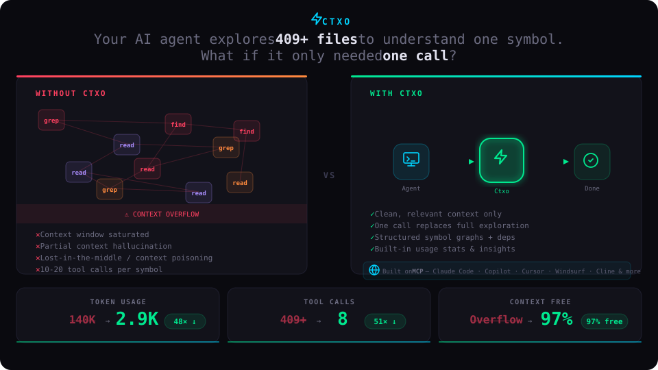
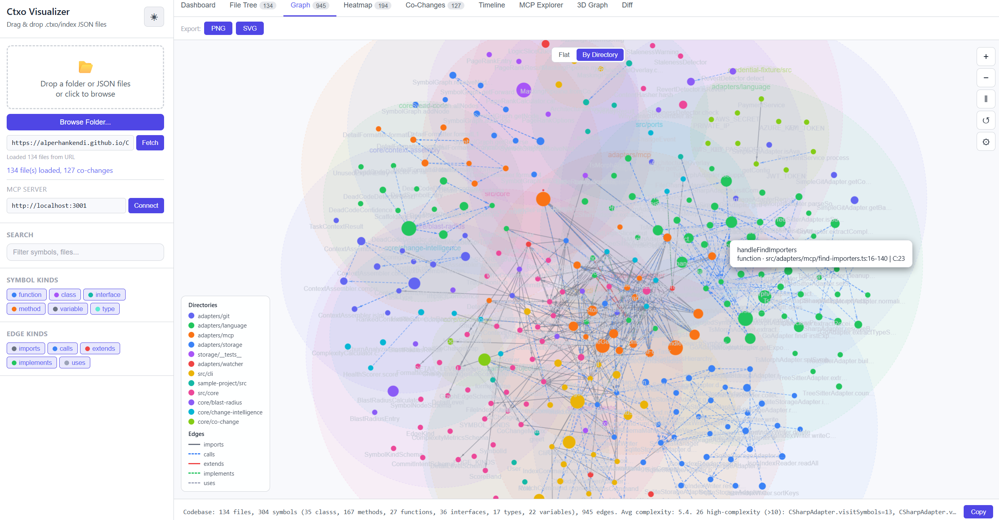
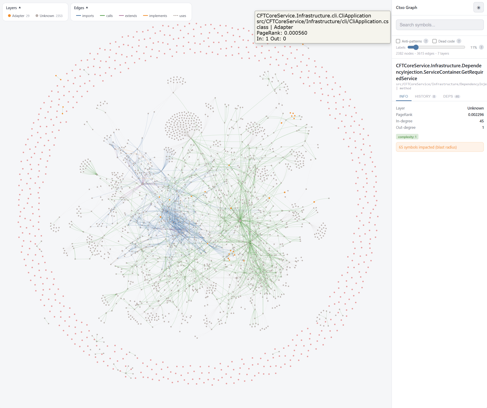

<div align="center">

[](https://www.npmjs.com/package/@ctxo/cli)
[](https://github.com/alperhankendi/Ctxo/actions/workflows/ci.yml)
[](https://github.com/alperhankendi/Ctxo/actions/workflows/release.yml)

<picture>
  <source media="(prefers-color-scheme: dark)" srcset="docs/img/hero-svg.svg">
  <source media="(prefers-color-scheme: light)" srcset="docs/img/hero-svg.svg">
  
</picture>

```Shell
npm install -g @ctxo/cli   # one-time global install (gives you the `ctxo` command)
ctxo init
ctxo index
```

<a href="https://alperhankendi.github.io/Ctxo/docs/">
  
</a>

<sub>Detects your languages, installs the right plugins, wires Ctxo into your AI client, installs git hooks, and builds the first index, all in one command.</sub>

</div>

***

## The Problem: agents code blind

Drop a modern coding agent into a real repo. It ripgreps a symbol, gets 47 hits, reads five files to find the definition, five more for callers, **misses the subclass entirely** (inheritance doesn't show up in text search), **never checks git history** (and confidently reintroduces a bug that was reverted three weeks ago), then runs out of context and starts hallucinating.

It's not a skill gap. It's a **sensory gap**. The agent is navigating your codebase with its eyes closed and a phone book.

## The Solution: proactive, not reactive

The core shift: your agent stops reacting to files it stumbles into and starts planning from a complete map. **Blast radius before the edit. Git intent before the bug fix. Importer list before the rename.**

Ctxo indexes your repo once, kept fresh by file watchers and git hooks, into a deterministic graph: every symbol, every edge (imports, calls, extends, implements, uses, and the data edges reads, writes and executes), every relevant git commit with intent classified, every anti-pattern. All exposed through 14 semantic MCP tools, plus 4 domain tools with `@ctxo/domain`.

One `get_blast_radius` call replaces an entire ripgrep/read spiral. One `get_pr_impact` replaces a full review session of "wait, what calls this?"

The agent still writes the code. It just stops writing it **blind**, so the bug never has to be caught by the compiler, the tests, CI, or a user.

## Codebase Dashboard

Full-stack analytics UI with eight views: File Tree, Heatmap, Co-Changes, Timeline, Architecture, MCP Explorer, and Diff. Deployed to GitHub Pages on every push.



[Open Dashboard](https://alperhankendi.github.io/Ctxo/ctxo-visualizer.html)

## Dependency Graph

`ctxo visualize` generates a self-contained HTML from your `.ctxo/` index. Interactive force-directed graph with PageRank sizing, layer coloring, blast radius on click, and dark/light theme.



[Open Dependency Graph](https://alperhankendi.github.io/Ctxo/visualize.html)

## Safe-Edit Guard

AI agents don't fail because they can't code. They fail because they code blind. Ctxo gives them the full picture before they write a single line.

The problem: an agent opens a file, makes a targeted edit, and walks away. It never checked what else depends on that symbol. Downstream callers silently break. Tests pass because the agent only ran the ones in the same file.

The safe-edit guard closes this loop deterministically. When you run `ctxo init`, it:

1. Registers a **PreToolUse hook** in `.claude/settings.json` (Claude Code) that intercepts every Edit call.
2. Installs three **model-invoked skills** (`ctxo-understand`, `ctxo-safe-edit`, `ctxo-review-pr`) so the agent knows when to check blast radius, history, and PR risk.

If an agent tries to edit a high-impact symbol without first calling `get_blast_radius`, the hook blocks the edit and tells the agent what to check. Once the agent runs the tool, the edit goes through normally. Fires once per symbol per session, fail-open on any uncertainty.

With the hook and the skills doing the work, the always-loaded `CLAUDE.md` block shrinks to four lines:

```markdown
## ctxo

This repo has a ctxo index: dependency graph, git intent, change health. For structural questions (who depends on X, what breaks if X changes, why X looks like this), use the ctxo MCP tools before grepping.
A pre-edit guard blocks the first edit to a high-impact symbol until `get_blast_radius` has been called for it.
Skills: `ctxo-understand` (orient at task start), `ctxo-safe-edit` (before changing a symbol), `ctxo-review-pr` (before reviewing a diff).
```

Every other client, Claude Code without the guard, and a `CLAUDE.md` that another client reads too (an `AGENTS.md` linked to it) get the full tool guide. Re-running `ctxo init` replaces the block in place and keeps the rest of your file. The blocks and skills are written in Prettier's layout and compared with formatting ignored, so a markdown formatter and ctxo never rewrite each other. `ctxo doctor` warns when the block, the skills or the hook drift, and `ctxo doctor --fix` repairs them.

**Pick the parts:**

```shell
ctxo init --only rules,skills,guard   # add the guard and the skills; the rules block follows
ctxo init --skip git-hooks            # everything except the git hooks
ctxo init --no-guard                  # does not install the guard (CLAUDE.md gets the full block unless a guard is already registered)
```

**Tune it:**

```shell
# Preview which symbols the guard would flag at current sensitivity
ctxo gate --preview

# Check blast radius for a specific symbol (pipe to jq, CI scripts, etc.)
ctxo blast-radius "src/core/graph.ts::buildGraph::function" --json
```

Configure sensitivity in `.ctxo/config.yaml`:

```yaml
gate:
  enabled: true
  sensitivity: balanced   # strict | balanced (DEFAULT) | lenient
```

**Platform matrix:**

| Platform | Hook enforcement | Skills | Rules |
|---|---|---|---|
| Claude Code | yes (PreToolUse blocks) | yes | yes |
| Cursor | no (no blocking pre-edit hook) | yes | yes |
| Other | no | where supported | yes |

## Fresh on every commit

A stale index is worse than none: the agent trusts a map that no longer matches the code. `ctxo init` installs a post-commit hook that runs `ctxo index --commit HEAD` once per commit. It re-indexes only the files that commit changed, refreshes the co-change matrix from git history, and records one snapshot per commit for the drift and boundary signals.

```shell
ctxo index --commit HEAD                                 # what the hook runs
ctxo index --files src/a.ts src/b.ts                     # re-index a few files
ctxo index --cochange-commits 500 --cochange-since 12m   # co-change window (or `cochange:` in config.yaml)
ctxo doctor --fix                                        # upgrades an old hook block in place
```

The file you forget to touch is usually the one no import points at. Files that keep changing together are coupled anyway: `get_blast_radius` promotes a dependent that co-changes with your target from `potential` to `likely`, and lists the files with no dependency path at all as `coChangedFiles`. `ctxo index --max-history` only controls how many commits each file keeps for `get_why_context`; the co-change window has its own settings.

## Where the boundaries really are

Folder names say one thing; imports and commit history often say another. `ctxo index` also writes candidate bounded contexts: files clustered by dependency and co-change edges, with hub files damped, each with a suggested label, a cohesion score, top terms and the edges that cross into other candidates. With `@ctxo/lang-sql` installed, tables, views and procedures join the graph: a table's readers and writers show up in its blast radius, and each candidate lists the tables it shares with other candidates.

```shell
ctxo contexts          # candidates as a table
ctxo contexts --json   # the full contexts-view.json
```

Agents get the same view from `get_architectural_overlay(mode: "contexts")`, and one candidate in full with `candidate: <id>`.

## Cards that go stale

An agent changes the lending rules in code, and the card that describes them stays as it was. Name your bounded contexts in a registry, and Ctxo checks the structure, never the meaning: a context's code changed in the session without a card update or a `Domain-Unchanged` commit trailer, a rule ID that no card defines, a card link that no longer resolves, an edge that crosses a context boundary outside its contracts. The opt-in `@ctxo/domain` package adds the commands and a Claude Code guard; Ctxo never writes the cards.

```shell
ctxo install domain                       # the opt-in @ctxo/domain package
ctxo init --domain                        # registry skeleton, fold guard, skill, domain config
ctxo contexts-touched --since origin/main # which named contexts a branch changed, and which are resolved
ctxo verify-domain --since origin/main    # CI gate: registry, cards, rule IDs, loader rules, boundaries, shadow specs
ctxo domain rules --write                 # path-scoped rules that point the agent at the card
ctxo domain discover                      # run first: propose tracker prefixes and test conventions from the repo
ctxo domain shadow-specs lending          # business logic in the lending code that no rule pins yet
ctxo domain map                           # every context with its rung, a suggested rung and what blocks the next one
```

With cards in place, `ctxo index` links each rule to the tests that pin it and the code that implements it, and the agent sees the rules while it works: `get_blast_radius` lists the rules a change may break and the cards to update, `get_why_context` the decisions behind them, `get_context_for_task` a card excerpt, `get_pr_impact` the contexts touched and the rules without tests. Four tools answer domain questions directly:

| Tool | Answers |
| --- | --- |
| `get_domain_context` | The card of the context that owns a symbol or file: terms, rules with their tests and code, contracts, decisions |
| `get_rule` | One rule by ID: the tests that pin it (and how each was found), the symbols that implement it, the decisions behind it |
| `find_shadow_specs` | The Deletion Test: literal comparisons, normalization, retry and timeout values, endpoints and data objects in a context that no rule pins yet, each with a stable fingerprint to resolve in `shadow-specs.yaml` |
| `get_context_map` | Every context with its tests, boundaries, drift and open candidates, the owner's rung and a suggested one, criterion by criterion |

`get_ranked_context` with `scope: "domain"` searches the cards and the documents they link to.

See [Ctxo domain conventions v1](docs/features/domain-knowledge.md#ctxo-domain-conventions-v1) for the registry, the card template and the adoption ladder.

## Supported Languages

| Language | Plugin | Tier | Notes |
|---|---|---|---|
| TypeScript / JavaScript | `@ctxo/lang-typescript` | full | ts-morph; type-aware cross-file resolution; decorators as annotations; test blocks as symbols; SQL at known call sites (pg, mysql2, mssql, knex, Prisma, TypeORM, Sequelize, better-sqlite3 raw SQL) |
| Go | `@ctxo/lang-go` | syntax / full | `ctxo-go-analyzer` full tier (Go 1.22+), tree-sitter fallback; struct tags as annotations; `_test.go` functions as symbols (full tier); SQL at known call sites (`database/sql`, sqlx, pgx, gorm raw; full tier) |
| C# | `@ctxo/lang-csharp` | full | Roslyn; .NET SDK 8+ for full tier, tree-sitter fallback |
| Java | `@ctxo/lang-java` | syntax / full | tree-sitter syntax tier built-in; full tier via `@ctxo/lang-java-analyzer` companion (JRE 11+ required, covers Java 8-21); detected by `pom.xml` / `build.gradle`; annotations in both tiers; test methods with their annotations; SQL at known call sites (JDBC, Spring `JdbcTemplate`, JPA native queries, MyBatis; full tier) |
| SQL (T-SQL) | `@ctxo/lang-sql` | syntax | `.sql` tables, views, procedures and functions with `reads` / `writes` / `executes` edges; no database or .NET needed. With it installed, the C# plugin's Roslyn tier also links constant SQL at ADO.NET, Dapper, `SqlBulkCopy` and EF Core call sites to the same tables, and so do the TypeScript, Java and Go plugins at their known call sites |

Install via the CLI shortcut:

```bash
ctxo install typescript go csharp   # syntax or full tier auto-detected
ctxo install sql                    # T-SQL plugin (alias tsql)
ctxo install domain                 # opt-in domain knowledge layer (@ctxo/domain)
ctxo install java                   # installs syntax tier; adds full-tier analyzer when JRE 11+ detected
ctxo install java --full-tier       # force full-tier analyzer install
ctxo install java --syntax-only     # skip analyzer, syntax tier only
```
[](https://mcprush.com/to/ctxo-cli-mcp?ref=badge)

## Links

* [Docs](https://alperhankendi.github.io/Ctxo/docs/): quick start, MCP tools, CLI reference, integrations
* [npm](https://www.npmjs.com/package/@ctxo/cli)
* [Changelog](CHANGELOG.md)
* [LLM Reference](llms-full.txt)

## License

MIT
